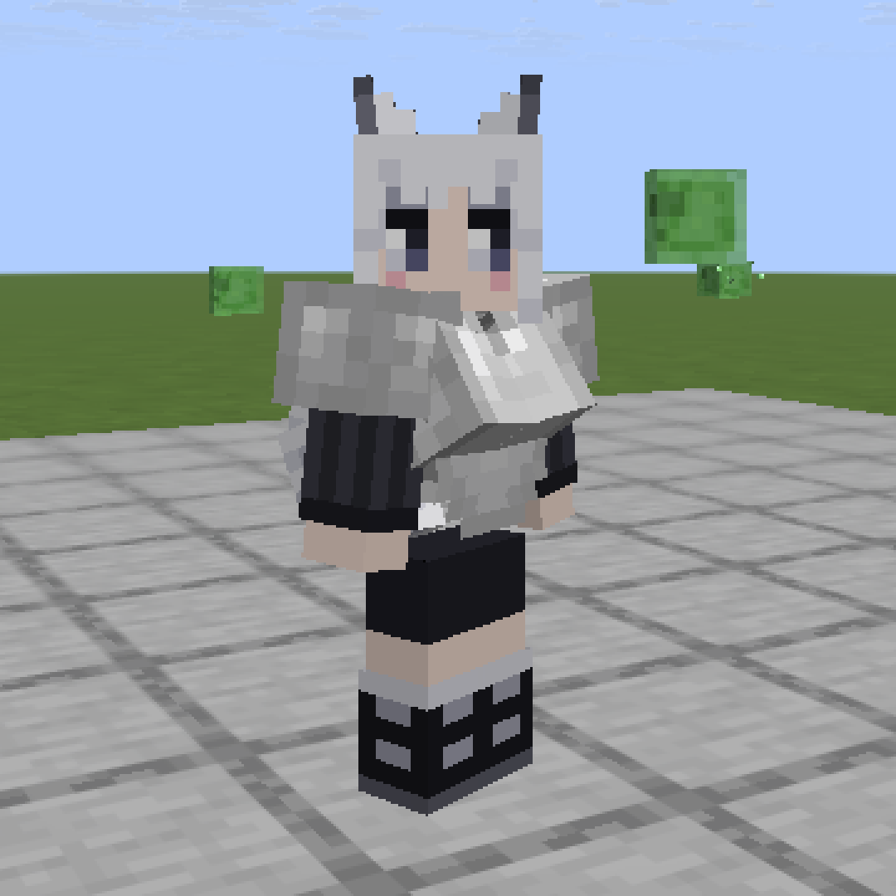

# Kotost Bust

A native mod for [Horizon](https://playhorizon.dev) (Minecraft: Java Edition 26.3 rewritten in Rust).
Mod id `kotost_body` (the name it had up to 0.3, "Kotost Body").

- **A bust for your own player**, drawn by the mod itself and textured from your own skin: no cosmetics item, no
  resource pack, no server plugin. Other players are left as they look unless you name them or choose slim skins
  or everyone in the settings (it only changes what you see on your screen).
- **It only moves when you move**: a small spring bounce on every step (harder when running) and on jumps and
  landings. Standing still, it stays still. Left and right have their own springs and never move quite in sync.
- **An hourglass figure**: every bust wearer gets a torso that narrows to the waist and widens to the hips, with
  their own skin stretched over it, instead of the game's box. The arms hang a little further out.
- **Chestplates keep the figure**: a vanilla chestplate is drawn in the same shape, with cups over the bust that
  bounce with it. Another mod's chestplate is left to the game (the box, no bust).

Everything is tuned in a text file while you play: who gets the bust, the figure, how much it bounces.

**First person** (your own body, legs and arms when you look down) is its own mod now:
[Kotost First Person](https://github.com/Leks2000/kotost-firstperson). Each works alone; together, your
first-person body has the bust and the figure too.

<table>
  <tr>
    <td width="50%"></td>
    <td width="50%"></td>
  </tr>
  <tr>
    <td width="50%"></td>
    <td width="50%"></td>
  </tr>
</table>

## Install

You need the Horizon launcher from [playhorizon.dev](https://playhorizon.dev) and a Microsoft account that owns
Minecraft: Java Edition.

1. Open the launcher, go to **Mods** and find **Kotost Bust** (once the registry lists it), or press
   **Add from GitHub** and paste `https://github.com/Leks2000/kotost-body`.
2. The launcher warns that a native mod runs with full access to your computer. That is true of every native mod:
   read the source first (a few short `.rs` files).
3. The launcher builds the game with the mod. **The first build takes a while** (it downloads Rust and Horizon's
   source; 20-40 minutes on an average PC). Later builds take a few minutes.
4. Press Play.

Command line, the same thing:

```
horizon-launcher mods add-github https://github.com/Leks2000/kotost-body --trust-native-code
```

The mod is client-side only. Servers need nothing; other players see the bust only if they have the mod too.

## Settings: `kotost-body.txt`

The mod writes `config/kotost-body.txt` in your game folder on its first run (the folder with `options.txt`; on
Windows by default `%APPDATA%\horizon\config\`). The game re-reads it twice a second: save the file and the change
shows in game, no restart. A line you delete goes back to its default.

Who gets the bust:

| Key | Default | What it does |
| --- | --- | --- |
| `skin_bust` | `me` | `me`: only you (plus `bust_names`). `off`: nobody. `names`: only the players in `bust_names`. `slim`: every player with a slim skin (3-pixel arms). `all`: everyone. |
| `bust_names` | empty | Player names, comma separated, that always get it, even with a wide skin. |
| `bust_skip` | empty | Player names, comma separated, that never get it. |

The figure:

| Key | Default | What it does |
| --- | --- | --- |
| `hourglass` | `1` | `0`: the game's box torso (the bust stays). |
| `waist` | `3.3` | Half-width of the waist, in skin pixels (the game's torso is 4). |
| `hips` | `4.3` | Half-width of the hips. |
| `hip_arms` | `3` | Degrees the arms hang further out, so the hips don't cut into them. |

Motion:

| Key | Default | What it does |
| --- | --- | --- |
| `bust` | `1` | `0` turns the motion off (the bust stays, still). |
| `walk` | `2.45` | How hard each step kicks it down. |
| `run_pow` | `0.4` | How much harder a run kicks than a walk (`0`: the same). |
| `jump` | `0.83` | How hard a jump or a landing kicks it. |
| `sway` | `0.12` | Sideways kick of each step, one foot then the other. |
| `vary` | `0.25` | How different the two sides and each kick are (`0`: in sync). |
| `k`, `c` | `2.0`, `0.75` | Spring stiffness and damping (lower `c` shakes longer). |
| `sway_k`, `sway_c` | `2.0`, `1.0` | The same for the sideways spring. |
| `down_max`, `up_max` | `4.0`, `3.0` | Limits, in skin pixels. |
| `move_px`, `turn_deg` | `0.45`, `5` | How the spring shows: shift up and down, and swing about the top edge. |

`debug = 1` writes `kotost-body-debug.log` in the game folder: for each player, once a second, whether the bust
was drawn and if not, why. Leave it off when you play.

`kotost-body.txt` in this repository is the file the mod writes, with every key at its default. The first-person
keys of 0.3 (`first_person`, `left_arm`, ...) moved to Kotost First Person, which carries them over on its first run.

A player who already wears a bust cosmetic item (parts named `bust_left` and `bust_right`) keeps theirs: the mod
draws no second one, and that item bounces with the same spring. The companion bot `Bolvanchik` always gets the
figure (`skin_bust = off` and `bust_skip` still turn it off).

## For other mods

`runtime.rs` is the module `horizon_client::kotost_body`. A mod that dresses the player can call `cloth(item_id)` so
its chest item counts as clothes (the bust and the figure stay under it), `cover(key)` to draw the bust itself in its
own cloth, and read `shaped(id)`, `waist_hips()`, `width_at(y, waist, hips)`, `bust_on(id)`, `jiggle(...)` and
`bust_part_pose(...)` to follow the figure ([Kotost Mage](https://github.com/Leks2000/kotost-mage) does).

## How it works

The bust is two boxes on the body bone, each tilted so its top edge lies flush on the chest and its bottom comes
forward; the tops meet at the centre and the bottoms part slightly. Every face takes its pixels from the body's own
skin: the front from the chest under it (so a shirt or a neckline carries on), the outer sides from the body's
sides, and the skin's jacket layer goes over it when the player shows it. The hourglass torso is a stack of
one-pixel rows, each as wide as the figure there, cut from the skin where the game's torso box takes it.

Hooks (all `HEAD`, see `horizon-mixin.toml`): `player_elytra_geometry` draws the bust and the figure on every
player, `anim::setup` and `player_model_visibility` leave the game's torso box undrawn for a shaped player,
`cosmetics_geometry` and `cosmetics_model` move a bust item. State and physics live in `runtime.rs`.

Built for Horizon `fdc87ae` (Nightly 2026-11-08); the launcher pins that commit when it builds the mod.

## License

MIT, see [LICENSE](LICENSE). Not affiliated with Mojang, Microsoft or the Horizon project.
