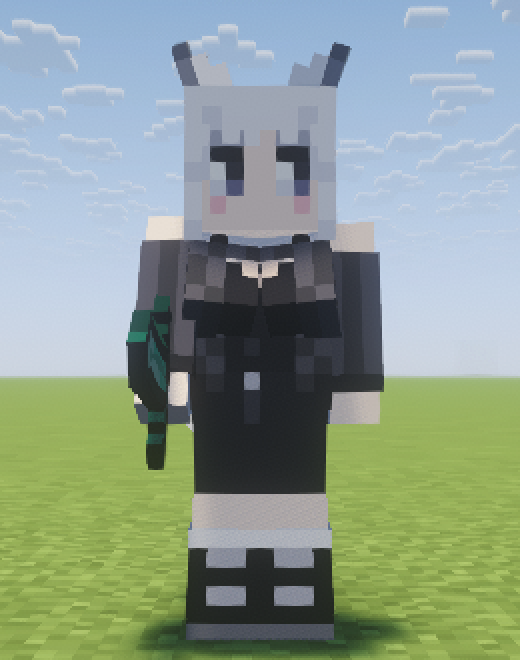
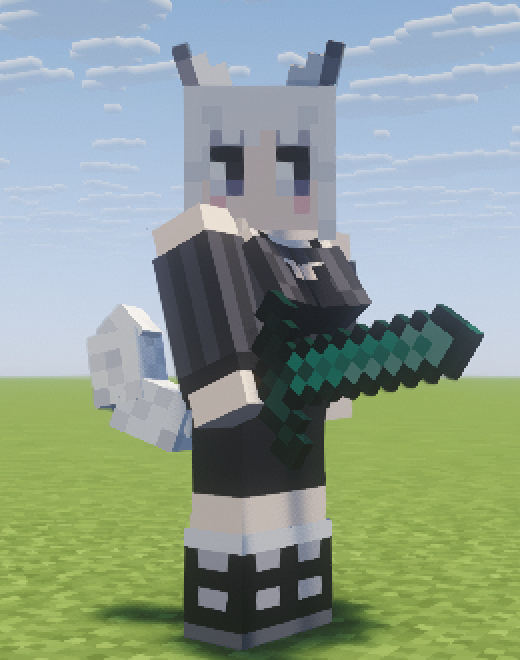
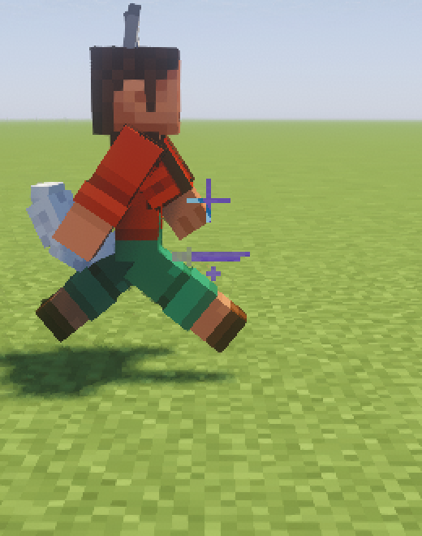
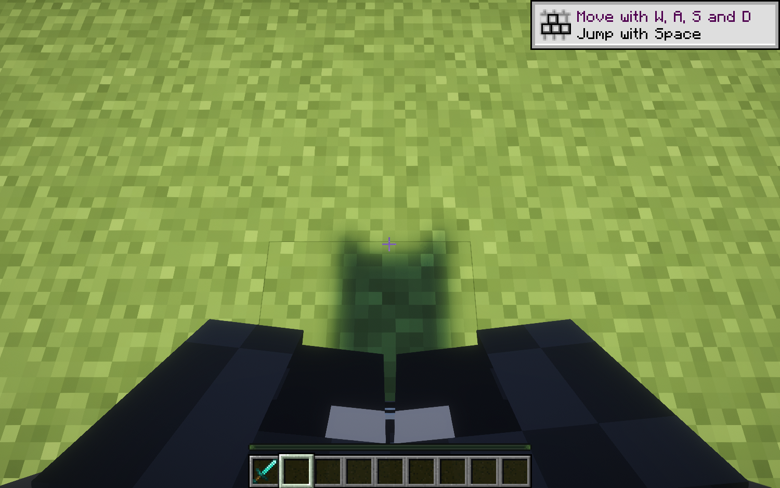

# Kotost Body

A native mod for [Horizon](https://playhorizon.dev) (Minecraft: Java Edition 26.3 rewritten in Rust).

- **A bust for players with a slim skin**, drawn by the mod itself and textured from each player's own skin:
  no cosmetics item, no resource pack, no server plugin. You see it on everyone, yourself included.
- **It only moves when you move**: a small spring bounce on every step (harder when running) and on jumps and
  landings. Standing still, it stays still. Left and right have their own springs and never move quite in sync.
- **Your own body in first person**: look down and you see your body, legs and both arms in 3D, holding your items,
  instead of the flat floating hands.

Everything is tuned in a text file while you play: who gets the bust, how much it bounces, the first-person view.

<table>
  <tr>
    <td width="50%"></td>
    <td width="50%"></td>
  </tr>
  <tr>
    <td width="50%"></td>
    <td width="50%"></td>
  </tr>
</table>

## Install

You need the Horizon launcher from [playhorizon.dev](https://playhorizon.dev) and a Microsoft account that owns
Minecraft: Java Edition.

1. Open the launcher, go to **Mods** and press **Add from GitHub**.
2. Paste `https://github.com/Leks2000/kotost-body` and confirm.
   The launcher warns that native mods are not reviewed by the Horizon registry and run with full access to your
   computer. That is true of every native mod: read the source first (it is a few short `.rs` files).
3. The launcher builds the game with the mod. **The first build takes a while** (it downloads Rust and Horizon's
   source; 20-40 minutes on an average PC). Later builds, after an update, take a few minutes.
4. Press Play.

Command line, the same thing:

```
horizon-launcher mods add-github https://github.com/Leks2000/kotost-body --trust-native-code
```

Update: `horizon-launcher mods update-github kotost_body`. Remove: Mods page, or `horizon-launcher mods remove kotost_body`.

The mod is client-side only. Servers need nothing; other players see the bust only if they have the mod too.

## Settings: `kotost-body.txt`

The mod writes `config/kotost-body.txt` in your game folder on its first run (the folder with `options.txt`; on
Windows by default `%APPDATA%\horizon\config\`). The game re-reads it twice a second: save the file and the change
shows in game, no restart. A line you delete goes back to its default.

Who gets the bust:

| Key | Default | What it does |
| --- | --- | --- |
| `skin_bust` | `slim` | `off`: nobody. `slim`: every player with a slim skin (3-pixel arms). `names`: only the players in `bust_names`. `all`: everyone. |
| `bust_names` | empty | Player names, comma separated, that always get it, even with a wide skin. |
| `bust_skip` | empty | Player names, comma separated, that never get it. |

Motion:

| Key | Default | What it does |
| --- | --- | --- |
| `bust` | `1` | `0` turns the motion off (the bust stays, still). |
| `walk` | `2.45` | How hard each step kicks it down. |
| `run_pow` | `0.4` | How much harder a run kicks than a walk (`0`: the same). |
| `jump` | `0.83` | How hard a jump or a landing kicks it. |
| `sway` | `0.12` | Sideways kick of each step, one foot then the other. |
| `vary` | `0.25` | How different the two sides and each kick are (`0`: in sync). |
| `k`, `c` | `2.0`, `0.75` | Spring stiffness and damping (lower `c` shakes longer). |
| `sway_k`, `sway_c` | `2.0`, `1.0` | The same for the sideways spring. |
| `down_max`, `up_max` | `4.0`, `3.0` | Limits, in skin pixels. |
| `move_px`, `turn_deg` | `0.45`, `5` | How the spring shows: shift up and down, and swing about the top edge. |

First person:

| Key | Default | What it does |
| --- | --- | --- |
| `first_person` | `1` | `0`: the game's usual first person. |
| `left_arm` | `1` | The model's left arm shows. |
| `right_arm` | `1` | The model's right arm and held items in 3D instead of the flat hands. |
| `back`, `back_down` | `0.0`, `0.27` | How far the body is pushed back (blocks), looking ahead and looking down. |

`debug = 1` writes `kotost-body-debug.log` in the game folder: for each player, once a second, whether the bust
was drawn and if not, why. Leave it off when you play.

`kotost-body.txt` in this repository is the file the mod writes, with every key at its default.

A player who already wears a bust cosmetic item (parts named `bust_left` and `bust_right`) keeps theirs: the mod
draws no second one, and that item bounces with the same spring.

## How it works

The bust is two boxes on the body bone, each tilted so its top edge lies flush on the chest and its bottom comes
forward; the tops meet at the centre and the bottoms part slightly. Every face takes its pixels from the body's own
skin: the front from the chest under it (so a shirt or a neckline carries on), the outer sides from the body's
sides, and the skin's jacket layer goes over it when the player shows it. A chestplate hides it, an elytra does not.

Hooks (all `HEAD`, see `horizon-mixin.toml`): `player_elytra_geometry` draws the bust on every player,
`cosmetics_geometry` and `cosmetics_model` move a bust item, the rest are the first-person body. State and physics
live in `runtime.rs`.

Built for Horizon `fdc87ae` (nightly 2026-11-08); the launcher pins that commit when it builds the mod.

## License

MIT, see [LICENSE](LICENSE). Not affiliated with Mojang, Microsoft or the Horizon project.
